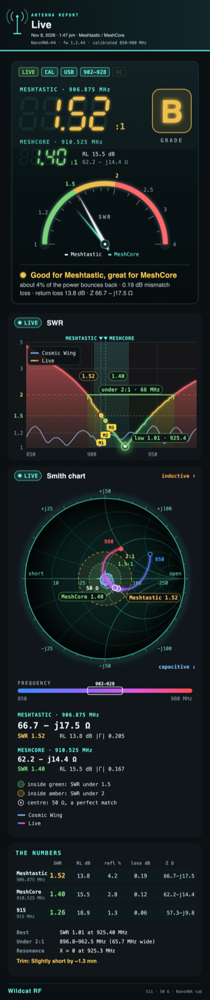

<div align="center">


</div>

<div align="center">


</div>

<h1 align="center">nanovna-tab</h1>

<p align="center">
  <b>A NanoVNA tab for Claude Code.</b><br>
  Plug the NanoVNA into your Mac, type <code>/vna</code>, and it reads your antenna every three seconds, grades it, and tells you in plain words what it means and what to do next.
</p>

<div align="center">

   [](LICENSE)

</div>

I test and tune antennas for my Meshtastic and MeshCore nodes. The NanoVNA knows everything about an antenna, but it says it in numbers on a 4-inch screen. I wanted those numbers to explain themselves, right where I already work. So I built this tab: it turns the NanoVNA into an instrument panel beside Claude Code, and it teaches you what you're looking at while you use it.

## Install

In Claude Code 2.1.275 or later, type:

```
/plugin install wildcat-vna --marketplace RedThoroughbred/nanovna-tab
```

In the Claude desktop app, `/plugin` opens the app's own plugin settings instead, so run this in a terminal:

```
claude plugin install wildcat-vna --marketplace RedThoroughbred/nanovna-tab
```

In a session that's already open, run `/reload-plugins`. Plug in the NanoVNA and type `/vna`.

## What you need

- **A Mac.** The tab finds the NanoVNA in the Mac's USB device tree and keeps its files under `~/Library`.
- **A NanoVNA running DiSlord's firmware 1.2.x.** Tested on a NanoVNA-H4 with 1.2.44. Many H4s only connect over a USB-A to USB-C cable.
- **Python 3.** `scripts/vna.py` uses the standard library only.
- **For PNG exports:** Google Chrome or `rsvg-convert`. Without either you still get the SVG.
- **The main band is the US mesh band, 902–928 MHz** (Meshtastic and MeshCore). The 868 MHz EU band isn't built in yet; other bands work through presets.
- **Wi-Fi is experimental.** The tab can also reach the NanoVNA through a Heltec V4 running a small bridge firmware, which isn't published yet. USB is the supported way.

## A tour

### Measure: the reading, the grade and what it means

<div align="center">


</div>

The big number is the SWR at the Meshtastic frequency (906.875 MHz), with MeshCore's (910.525 MHz) under it, a meter, a letter grade and one line that says what it means. The colours follow the usual zones: under 1.5 is excellent, under 2 is good, above 3 is poor.

<div align="center">


</div>

Under the reading: the SWR, verdict and impedance at 906.875, 910.525 and 915 MHz, the NanoVNA's own markers, and a trim hint. For a simple whip it says which way to go and about how far ("slightly short by ~1.1 mm").

### Four ways to see one sweep

<div align="center">


</div>

SWR, return loss, R & X and the Smith chart, each with the mesh band marked and a few lines under it on how to read it. A saved antenna can sit on the chart beside the live trace.

### Trim: the live trim assistant

<div align="center">


</div>

For cutting or bending an antenna. It shows where the antenna resonates now against the target and which way to go, and logs every change on a timeline. Cut past the target and it tells you, and how to undo it.

### Library and compare

| | |
|---|---|
|  |  |

Save an antenna by name and it becomes a card in its own colour, with every version kept. Pick A and B to compare two: the better value gets a star, and both curves share the chart.

### QC: PASS or FAIL

<div align="center">


</div>

For testing units: a PASS or FAIL stamp from your rule (by default SWR 2 or better across 902–928 MHz, and 1.5 or better at both mesh frequencies), a CSV log, and a certificate for each unit you save.

### Bands

<div align="center">


</div>

2 m, 70 cm, ADS-B 1090, 433 MHz ISM, FM broadcast and bands of your own, each calibrated into its own save slot. Power-on is always slot 0, the mesh layout, and nothing writes it unless you ask by name.

<div align="center">


</div>

The V4 dipole helper gives each element's length for the RTL-SDR Blog V4 kit's dipole, then sweeps that band so you can confirm the dip.

### The guide

<div align="center">


</div>

Press **?** for how the tab works and what your NanoVNA can do, checked against DiSlord's firmware source.

### When nothing is connected

<div align="center">


</div>

An open port, a loose connector or an RP-SMA antenna on an SMA port reads as nothing on PORT 1, and the tab says what to check.

### 📸 Export: a report card

<div align="center">

[](docs/images/report-card.png)

</div>

One press makes a tall report card from the tab's own pictures, as an SVG and a 1080-pixel-wide PNG, ready to share.

## Ask Claude

Version 0.7.0 lets Claude use the NanoVNA too. Three tools and a skill come with the plugin, so you can just talk:

- "How is my antenna doing?" Claude reads the NanoVNA and tells you the SWR, the grade and what it means.
- "Walk me through trimming this whip to 906.875." Claude asks for one small cut, reads the antenna again after each one, and says closer, passed it, or on frequency.
- "Which of my saved antennas is best, and did my last trim help?" Claude reads your Library and compares them.

Claude can read the antenna, read your saved antennas, and do the safe things the buttons do: save an antenna, place the markers, switch bands, log a trim step and make the report card. The `antenna-coach` skill teaches it to explain SWR, return loss, R & X and the Smith chart, and to coach a trim, in plain words. [The details](docs/details.md#tools-for-claude) list every tool.

> [!WARNING]
> Claude can't calibrate, save the power-on layout, delete an antenna or write a NanoVNA save slot. Those stay in the tab, where you confirm them. And never connect a transmitting radio to the NanoVNA.

## What's new in 0.8.0

- **Renamed for Anthropic's plugin directory:** the plugin is now `wildcat-vna` (shown as Wildcat VNA). The `/vna` command works as before. If you installed it under the old name, run `claude plugin uninstall vna@nanovna-tab`, then the new install line above, then `/reload-plugins`. Your saved antennas stay; a few tab preferences, such as colours and toggles, start fresh.

## What's new in 0.7.0

- **Tools for Claude:** `vna_reading`, `vna_antennas` and `vna_action`, so Claude can read the antenna, your Library, and do the safe button presses.
- **The `antenna-coach` skill:** teaches Claude to read SWR, return loss, R & X and the Smith chart, and to run the trim loop with you.
- A tool press and a click on the tab share one queue, so they never collide.

## Updating

```
claude plugin marketplace update nanovna-tab
claude plugin update wildcat-vna@nanovna-tab
```

Then run `/reload-plugins` in a session that's already open.

## How it works

- The tab talks to the NanoVNA through `scripts/vna.py`, a standard-library Python script that also works on its own.
- It finds the NanoVNA by its USB name, so it never opens another serial device.
- Several Claude sessions can have the tab open. Only one talks to the NanoVNA; the others share its reading.
- It sweeps only while a VNA tab is on screen somewhere.
- Every button answers on the first click and says what it's doing.

[The details](docs/details.md) cover every button, command and file.

> [!WARNING]
> Never connect a transmitting radio, or a node's antenna output, to the NanoVNA. It can destroy the NanoVNA's input.

## What it runs and sends

- **Programs it starts:** `python3 scripts/vna.py` (the plugin's own script, standard library only) to talk to the NanoVNA, and `/usr/bin/open` when you press an "open" button for a log, a folder, a certificate or a screenshot. `vna.py` runs `/usr/sbin/ioreg` to find the NanoVNA in the USB device tree, and for PNG exports it runs headless Google Chrome (a throwaway profile) or `rsvg-convert`, whichever is installed. Nothing else is started, and nothing is installed.
- **The NanoVNA:** the script opens only the serial port of the device named NanoVNA, and sends it the same console commands you could type yourself. It does not calibrate, save the power-on layout or write a save slot unless you ask in the tab.
- **Files it writes:** your antennas, sweeps, screenshots, QC log and certificates and report cards in `~/NanoVNA`; the tab's state (the latest reading, band presets, calibration records, a log of button presses) in `~/Library/Application Support/vna`; a lock and a lease file in `~/Library/Caches/vna`; the status line in `~/.claude/mod-status/vna.json` (for the Herdr app's strip); and the tab's own preferences (colours, view, toggles) in Claude Code's per-plugin store.
- **Network:** the plugin opens no port and sends nothing to any server. The one exception is the experimental Wi-Fi option, and it is off unless you create `~/Library/Application Support/vna/bridge.json`: then the script makes a TCP connection (port 23 by default) to the host or address you put in that file, a Heltec V4 bridge on your own network, and talks to the NanoVNA through it. Without that file the script never touches the network.
- **Nothing goes to Anthropic or anyone else from the plugin itself.** What Claude reads through the three tools (`vna_reading`, `vna_antennas`, `vna_action`) becomes part of your conversation like any other tool result.

## Wildcat RF

nanovna-tab is part of Wildcat RF, the radio instruments I build for Claude Code. Its sibling is [rtl-sdr-tab](https://github.com/RedThoroughbred/rtl-sdr-tab) (the `wildcat-radio` plugin, Wildcat Radio), a Radio tab for the RTL-SDR Blog V4, in the same instrument look.

I built it with Claude Code as my coding partner.

## License

MIT. See [LICENSE](LICENSE). An independent project, not affiliated with the NanoVNA makers or DiSlord.
