<p align="center">
  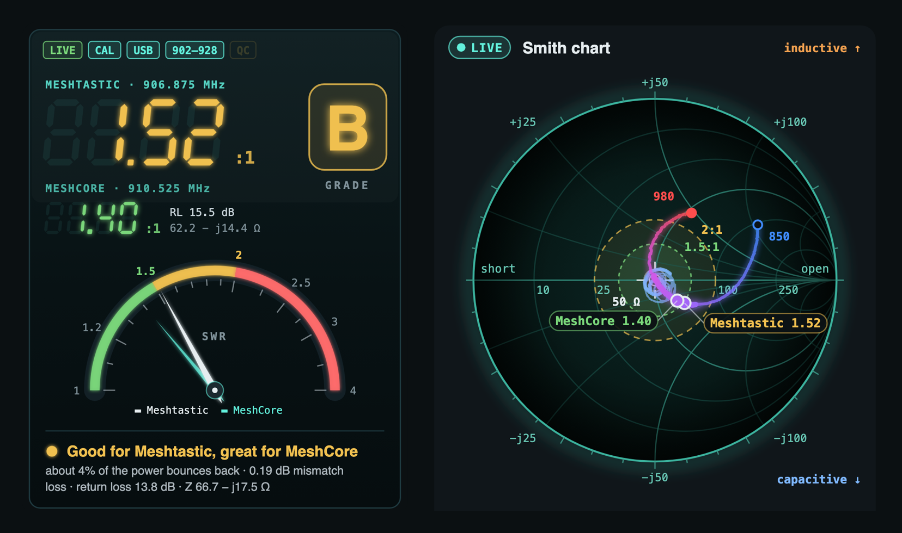
</p>

<h1 align="center">nanovna-tab</h1>

<p align="center">
  <b>A NanoVNA tab for Claude Code.</b><br>
  Plug the NanoVNA into your Mac, type <code>/vna</code>, and it reads your antenna every three seconds, grades it, and tells you in plain words what it means and what to do next.
</p>

<p align="center">
  
  
  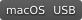
  <a href="LICENSE"></a>
</p>

I test and tune antennas for my Meshtastic and MeshCore nodes. The NanoVNA knows everything about an antenna, but it says it in numbers on a 4-inch screen. I wanted those numbers to explain themselves, right where I already work. So I built this tab: it turns the NanoVNA into an instrument panel beside Claude Code, and it teaches you what you're looking at while you use it.

## Install

In Claude Code 2.1.275 or later:

```
/plugin install vna --marketplace RedThoroughbred/nanovna-tab
```

Plug in the NanoVNA and type `/vna`.

## What you need

- **A Mac.** The tab finds the NanoVNA in the Mac's USB device tree and keeps its files under `~/Library`.
- **A NanoVNA running DiSlord's firmware 1.2.x.** Tested on a NanoVNA-H4 with 1.2.44. Many H4s only connect over a USB-A to USB-C cable.
- **Python 3.** `scripts/vna.py` uses the standard library only.
- **For PNG exports:** Google Chrome or `rsvg-convert`. Without either you still get the SVG.
- **The main band is the US mesh band, 902–928 MHz** (Meshtastic and MeshCore). The 868 MHz EU band isn't built in yet; other bands work through presets.
- **Wi-Fi is experimental.** The tab can also reach the NanoVNA through a Heltec V4 running a small bridge firmware, which isn't published yet. USB is the supported way.

## A tour

### Measure: the reading, the grade and what it means

<p align="center">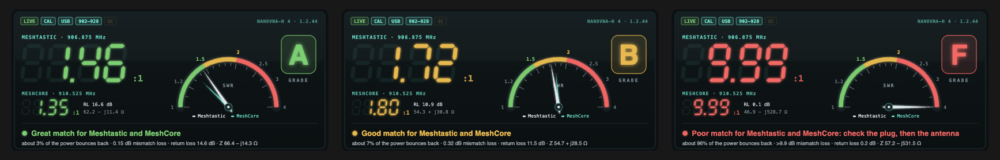</p>

The big number is the SWR at the Meshtastic frequency (906.875 MHz), with MeshCore's (910.525 MHz) under it, a meter, a letter grade and one line that says what it means. The colours follow the usual zones: under 1.5 is excellent, under 2 is good, above 3 is poor.

<p align="center">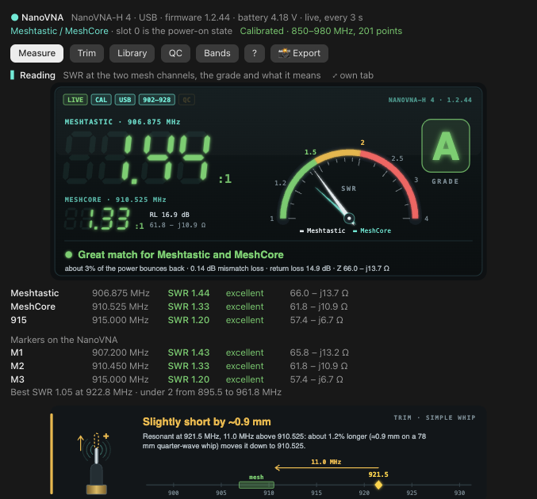</p>

Under the reading: the SWR, verdict and impedance at 906.875, 910.525 and 915 MHz, the NanoVNA's own markers, and a trim hint. For a simple whip it says which way to go and about how far ("slightly short by ~1.1 mm").

### Four ways to see one sweep

<p align="center">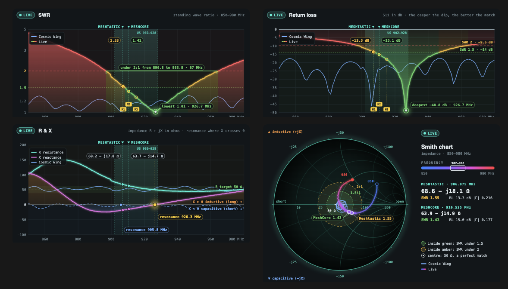</p>

SWR, return loss, R & X and the Smith chart, each with the mesh band marked and a few lines under it on how to read it. A saved antenna can sit on the chart beside the live trace.

### Trim: the live trim assistant

<p align="center">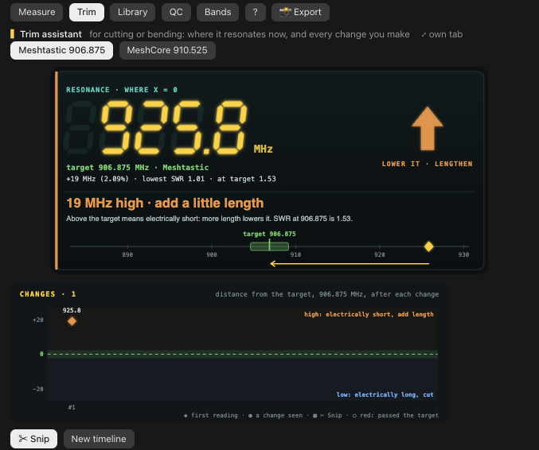</p>

For cutting or bending an antenna. It shows where the antenna resonates now against the target and which way to go, and logs every change on a timeline. Cut past the target and it tells you, and how to undo it.

### Library and compare

<table>
<tr>
<td width="50%">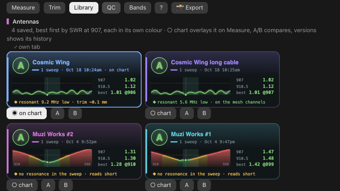</td>
<td width="50%">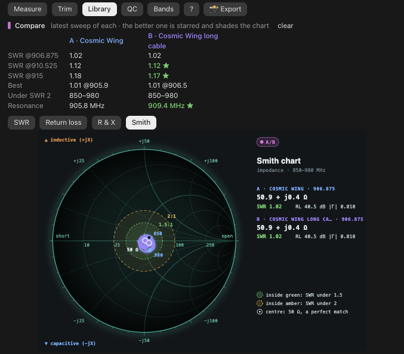</td>
</tr>
</table>

Save an antenna by name and it becomes a card in its own colour, with every version kept. Pick A and B to compare two: the better value gets a star, and both curves share the chart.

### QC: PASS or FAIL

<p align="center">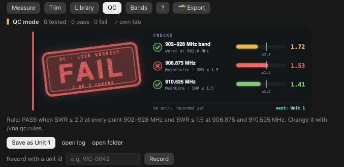</p>

For testing units: a PASS or FAIL stamp from your rule (by default SWR 2 or better across 902–928 MHz, and 1.5 or better at both mesh frequencies), a CSV log, and a certificate for each unit you save.

### Bands

<p align="center">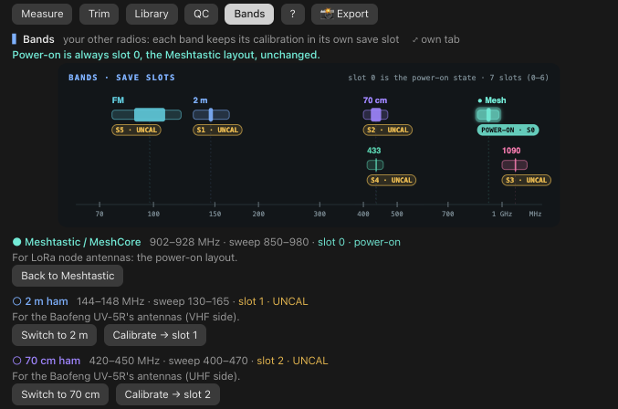</p>

2 m, 70 cm, ADS-B 1090, 433 MHz ISM, FM broadcast and bands of your own, each calibrated into its own save slot. Power-on is always slot 0, the mesh layout, and nothing writes it unless you ask by name.

<p align="center">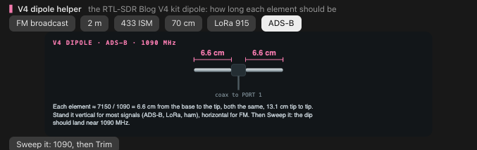</p>

The V4 dipole helper gives each element's length for the RTL-SDR Blog V4 kit's dipole, then sweeps that band so you can confirm the dip.

### The guide

<p align="center">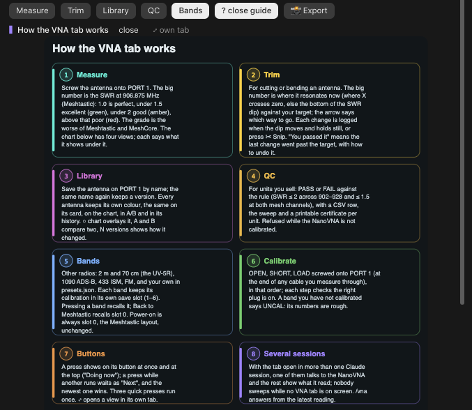</p>

Press **?** for how the tab works and what your NanoVNA can do, checked against DiSlord's firmware source.

### When nothing is connected

<p align="center">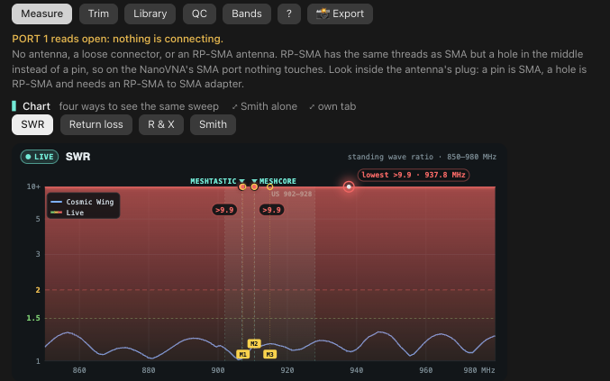</p>

An open port, a loose connector or an RP-SMA antenna on an SMA port reads as nothing on PORT 1, and the tab says what to check.

### 📸 Export: a report card

<p align="center"><a href="docs/images/report-card.png">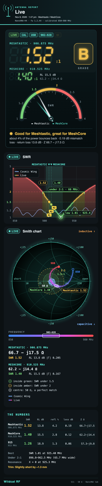</a></p>

One press makes a tall report card from the tab's own pictures, as an SVG and a 1080-pixel-wide PNG, ready to share.

## How it works

- The tab talks to the NanoVNA through `scripts/vna.py`, a standard-library Python script that also works on its own.
- It finds the NanoVNA by its USB name, so it never opens another serial device.
- Several Claude sessions can have the tab open. Only one talks to the NanoVNA; the others share its reading.
- It sweeps only while a VNA tab is on screen somewhere.
- Every button answers on the first click and says what it's doing.

[The details](docs/details.md) cover every button, command and file.

> [!WARNING]
> Never connect a transmitting radio, or a node's antenna output, to the NanoVNA. It can destroy the NanoVNA's input.

## Wildcat RF

nanovna-tab is part of Wildcat RF, the radio instruments I build for Claude Code. Its sibling, a Radio tab for the RTL-SDR Blog V4, is on its way.

I built it with Claude Code as my coding partner.

## License

MIT. See [LICENSE](LICENSE). An independent project, not affiliated with the NanoVNA makers or DiSlord.
