# nanovna-tab: the details

Everything the VNA tab does, place by place, and how it keeps your NanoVNA's power-on settings safe.

New here? Start with the [README](../README.md): it has the pictures, the install line and what you need.

**On this page**

- [First run](#first-run)
- The five places: [Measure](#measure) · [Trim](#trim) · [Library](#library) · [QC](#qc) · [Bands](#bands)
- [Calibrating](#calibrating)
- [The guide](#the-guide) and [the report card](#the-report-card)
- [The status line](#the-status-line)
- [Commands](#commands)
- [How it works](#how-it-works)
- [Files](#files)
- [Tests](#tests)

## First run

Three steps, and the tab is reading your antenna.

1. **Plug the NanoVNA into the Mac.** Many NanoVNA-H4s only connect over a USB-A to USB-C cable.
2. **Screw the antenna onto PORT 1.**
3. **Type `/vna`.** The tab opens on Measure and reads the antenna every three seconds.

If the band row at the top says **UNCAL**, [calibrate](#calibrating) first. The numbers are rough until you do.

> [!WARNING]
> Never connect a transmitting radio, or a node's antenna socket while it can transmit, to the NanoVNA. Its ports are made for the tiny signal it sends itself, and a transmitter's power can destroy them. Test antennas, not live outputs.

> [!IMPORTANT]
> **Power-on is always slot 0, the Meshtastic layout, unchanged.** Only two things in the tab write slot 0, and only when you ask for them by name: the mesh calibration (Calibrate on the 850–980 MHz band) and **Make this my power-on layout** in Bands, which asks first. Band presets use slots 1–6.

### The top of the tab

The rows at the top of every place say what the NanoVNA is doing.

| Row | What it shows |
|---|---|
| **NanoVNA** | The board, USB or Wi-Fi, the firmware, the battery, and whether it's live (every 3 s) or paused |
| **The band** | The band being swept, its save slot, and whether its calibration is good for it: **CAL**, or **UNCAL** in amber with the reason |
| **Doing now** | While a press runs: its step, and about how long it takes |
| **Next** | The press waiting behind it |

### Getting around

One row of buttons runs across the top: **Measure · Trim · Library · QC · Bands**, then **?** for [the guide](#the-guide) and **📸 Export** for [the report card](#the-report-card). The tab remembers where you were.

Every big view also opens in its own tab: press ⤢ on its title row, or type `/vna tab <view>`. An own tab draws that view alone, with the same top rows, and reads well on the phone.

| `/vna tab …` | Opens |
|---|---|
| `reading` | The big readout and the readings |
| `chart` | The chart with its four views |
| `smith` | The Smith chart alone |
| `trim` | The trim assistant |
| `library` | The antenna library |
| `qc` | QC mode |
| `bands` | The band presets and the power-on layout |
| `guide` | How the tab works |

## Measure

How well does this antenna match right now? Measure answers at a glance, then shows the detail.

<p align="center">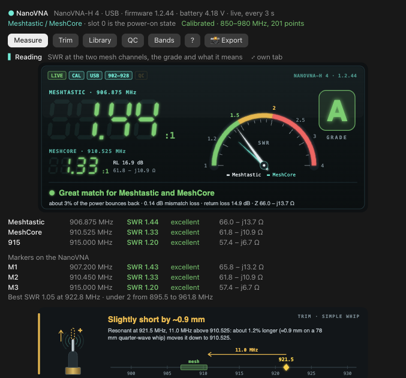</p>

**The big readout.** The SWR at Meshtastic's 906.875 MHz in large seven-segment digits, MeshCore's 910.525 MHz in small ones under it, an SWR meter, a letter grade, and one line saying what it means. The grade is the worse of the two frequencies.

| Grade | SWR | What it means |
|---|---|---|
| **A** | 1.5 or less | Great match: about 4% or less of the power bounces back |
| **B** | 2 or less | Good match: about 11% or less bounces back |
| **C** | 3 or less | So-so: worth a trim or a better antenna |
| **F** | over 3 | Poor: check the plug, then the antenna. More than 25% bounces back |

SWR numbers keep the same zone colours everywhere in the tab: green to 1.5, amber to 2, red above.

**Under the readout:** the SWR, verdict and impedance at 906.875, 910.525 and 915 MHz; the NanoVNA's own markers; the best point and the stretch under SWR 2; and a trim hint with a drawing of the whip, saying which way to go and about how far ("Slightly short by ~0.9 mm").

**The chart** shows one sweep four ways. Each view marks the mesh band and has a few lines under it on how to read it.

<p align="center">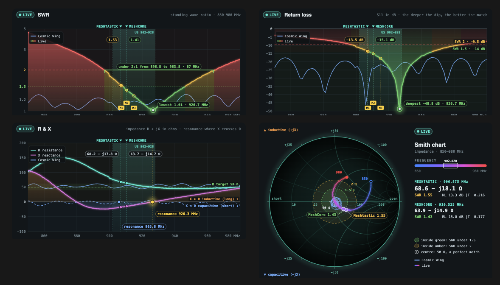</p>

| View | How to read it |
|---|---|
| **SWR** | The wave sent out against the wave bouncing back. 1.0 is a perfect match. The teal stripe is the US 902–928 MHz band, the bracket the stretch under 2:1, and the ringed dot the lowest point. The scale is stretched toward 1, where the detail is |
| **Return loss** | How far below the outgoing wave the reflection is, in dB: the deeper the dip, the better. 10 dB is SWR 1.9, 14 dB is SWR 1.5, 20 dB is SWR 1.22. The NanoVNA's LOGMAG trace is this same curve |
| **R & X** | The antenna as a resistance R in series with a reactance X. The goal is R = 50 Ω and X = 0. Where X crosses 0, the antenna resonates. X below 0 is capacitive (for a whip, electrically short); above 0 it's inductive (electrically long) |
| **Smith** | R and X folded into one picture. The centre is 50 Ω, a perfect match; the right edge is an open circuit, the left a short. Inside the amber circle the SWR is under 2, inside the green one under 1.5 |

A saved antenna can sit on the chart beside the live trace (**○ chart** in the [Library](#library)).

**On another band** (see [Bands](#bands)), the readout and the readings move to that band's target: 2 m calling 146.52, 70 cm calling 446, ADS-B 1090, and so on. The chart marks that band, and the status line says `VNA · 2 m · SWR 1.41 @146.52`.

**The buttons under the chart:**

| Button | What it does |
|---|---|
| **Pause live** | Stops the 3-second reading. **Resume live** starts it again |
| **Save** | Saves the antenna on PORT 1 to the [Library](#library). A name field on the desktop (the same name again adds a version); one press on the phone ("Save as Antenna N") |
| **Calibrate** | OPEN, SHORT, LOAD for the band you're on: slot 0 on the mesh band, the band's own slot elsewhere. See [Calibrating](#calibrating) |
| **Screenshot** | A picture of the NanoVNA's own screen, saved to `~/NanoVNA/screenshots` |
| **Trace 4: X** | Shows the reactance X on the NanoVNA's screen, without saving. See [the optional 4th trace](#the-optional-4th-trace) |
| **Mesh layout** | Sets 850–980 MHz, the SWR, Smith and dB traces, and markers at 907, 910.5 and 915, without saving. Back to Meshtastic recalls slot 0 with its calibration |

> [!TIP]
> **PORT 1 reads open?** No antenna, a loose connector or an RP-SMA antenna all read as nothing on PORT 1, and the tab says what to check. RP-SMA has the same threads as SMA but a hole in the middle instead of a pin, so on the NanoVNA's SMA port nothing touches. Look inside the antenna's plug: a pin is SMA; a hole is RP-SMA and needs an RP-SMA to SMA adapter.

## Trim

For cutting or bending an antenna: where it resonates now, which way to go, and every change you make along the way.

<p align="center">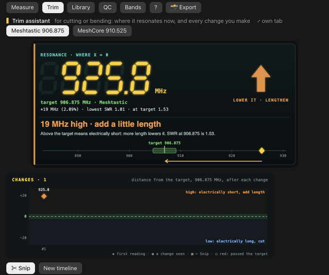</p>

**Where it resonates.** The big number is where the reactance X crosses zero going up (the crossing nearest the target, if there are several). A well-matched antenna with no crossing uses the middle of the SWR dip's floor instead. The target is Meshtastic's 906.875 MHz by default and MeshCore's 910.525 a press away; every band has its own.

**What it tells you.** Below the target means the antenna is electrically long, so shortening raises it. Above means it's short, so more length lowers it.

| How far from the target | Below it | Above it |
|---|---|---|
| Within ±0.25% (2.3 MHz at 907), or one sweep step | On frequency ✓ | On frequency ✓ |
| Under 0.6% | trim a hair | a hair longer |
| 0.6% to 3% | cut a little | add a little length |
| 3% or more | cut more | add length |

So `12 MHz low · cut a little` means about 1.3% low at 907. Two more phrases to know:

- **closer…** goes in front when your last change got closer: `closer… 4.4 MHz low · cut a little`.
- **You passed it · now 6.1 MHz high** means your last change crossed the target. It comes with how to undo it, for example: "that cut went too far. Undo: lengthen a touch (straighten a bend, solder a short extension or slide a sleeve on the tip), or stop here if the SWR is fine."

If the dip is off the edge of the sweep, the tab says so. Below the bottom edge is "much too long": cut in small steps until the dip comes into view. Above the top edge is "much too short": it needs more length, or a different antenna.

**The timeline** under it logs each change:

- by itself, when the resonance has moved 0.4% (3.6 MHz at 907) and two readings in a row agree, so just handling the antenna logs nothing;
- or when you press **✂ Snip**.

Each step keeps its time, where it resonated, how that was found and the SWR at the target. The chart shows each step as a dot above (short) or below (long) the target line, with a passed one ringed in red. Changing the target re-measures the whole timeline, and **New timeline** starts over.

Trim uses the live sweep and changes nothing on the NanoVNA. From the command line: `/vna trim` prints it, `/vna trim snip` logs a change, `/vna trim 915` aims at a frequency, and `/vna trim reset` starts a new timeline.

## Library

Save an antenna by name and it lands here as a card. Save the same name again and it keeps a new version, so you can see how the antenna changed.

<table>
<tr>
<td width="50%">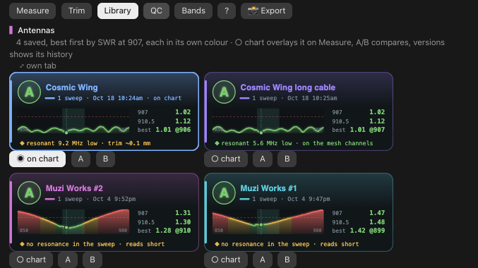</td>
<td width="50%">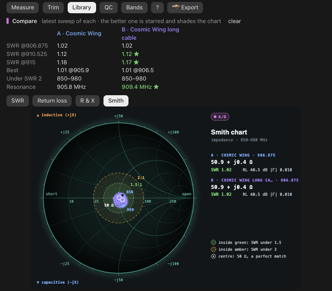</td>
</tr>
</table>

The cards are sorted best first, by SWR at 907. **Each antenna has its own colour**, kept for good: a new antenna takes the colour the fewest others have. The same colour marks it everywhere: its card (frame, header tint, bar and name), its overlay on the Measure chart, A or B in a compare, and the shades of its history. The terminal shows each name in its colour.

The grade, the sparkline and the numbers keep the SWR zone colours. Green, amber and red are never an antenna's colour, and yellow is always the live trace.

| Button | What it does |
|---|---|
| **○ chart** | Overlays this antenna on the Measure chart, beside the live trace |
| **A**, **B** | Picks two antennas to compare: a table of SWR, best point and resonance with the better value starred, and both curves on one chart |
| **N versions** | Overlays this antenna's history, oldest dim and newest bright |

From the command line: `/vna save <name>`, `/vna compare <a> <b>` (`/vna compare off` clears it), `/vna history <name>` (`/vna history off`), and `/vna delete <name>`, which removes that antenna's newest version.

## QC

For testing units before they go out: a PASS or FAIL stamp against your rule, a CSV log, and a certificate for each unit you save.

<p align="center">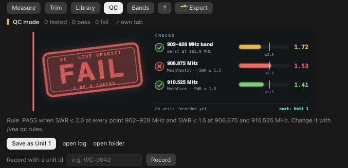</p>

**The rule.** By default a unit passes with SWR 2 or better at every point across 902–928 MHz, and 1.5 or better at both mesh frequencies. Each check gets its own meter, so you can see how close it came. Change the rule from the command line:

```
/vna qc rules band=2.0 spot=1.5 range=902-928 spots=906.875,910.525
/vna qc rules default
```

**Recording a unit.** **Save as Unit N** (or a unit id you type, on the desktop) writes three things:

- a row in `~/NanoVNA/qc-log.csv`;
- the sweep, as a Touchstone `.s1p` file in `~/NanoVNA/qc/`;
- a one-page certificate beside it.

Saving is refused while the NanoVNA is not calibrated. The verdict is worked out in the tab from the live curve, with the same rule as `vna.py`, so every Claude session gets it from the one shared reading. QC tests mesh units: on another band it asks you to press Back to Meshtastic first.

From the command line: `/vna qc` turns QC mode on, `/vna qc off`, `/vna qc save [unit]`, `/vna qc rules …`, and `/vna qc log` lists the records, newest first.

## Bands

Your other radios. Each band keeps its own calibration in its own save slot, so switching bands never touches slot 0, the mesh layout.

<p align="center">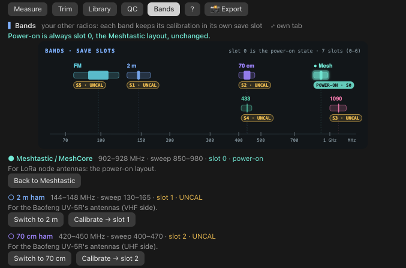</p>

The band map shows each band in its colour, with its slot and **CAL** or **UNCAL**; the one being swept glows. It's drawn on a log frequency scale with tooltips on the desktop, and as rows on the phone.

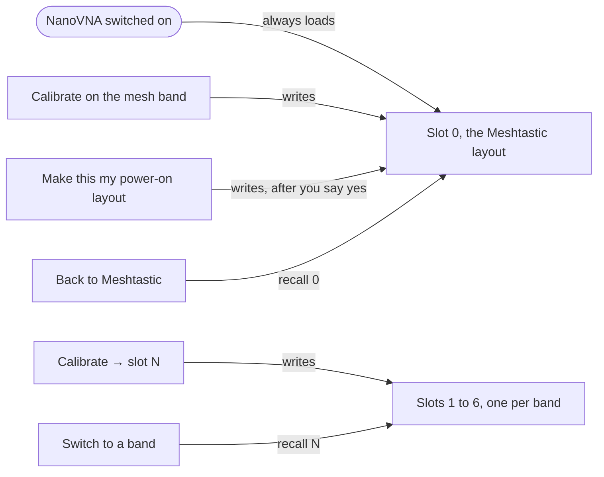

**Built in**, each swept at 201 points and a little wider than its band, so a dip that's off still shows:

| Band | For | Sweep | Target | Slot | `id` |
|---|---|---|---|---|---|
| Meshtastic / MeshCore, 902–928 MHz | LoRa node antennas | 850–980 MHz | 906.875 / 910.525 | **0**, power-on | `mesh` |
| 2 m ham, 144–148 MHz | The Baofeng UV-5R's antennas (VHF) | 130–165 MHz | 146.52 | 1 | `2m` |
| 70 cm ham, 420–450 MHz | The Baofeng UV-5R's antennas (UHF) | 400–470 MHz | 446.0 | 2 | `70cm` |
| ADS-B 1090, 1087–1093 MHz | Plane-tracking antennas | 1000–1180 MHz | 1090 | 3 | `adsb` |
| 433 MHz ISM, 433.05–434.79 MHz | Weather-sensor and gadget antennas | 410–456 MHz | 433.92 | 4 | `ism433` |
| FM broadcast, 88–108 MHz | FM receive antennas | 76–120 MHz | 98 | 5 | `fm` |

Slot 6 is free for a band of your own.

**The buttons for each band:**

| Button | Command | What it does |
|---|---|---|
| **Switch to 2 m** | `/vna band 2m` | A calibrated band: recalls its slot, then checks the sweep is the band's (a slot the NanoVNA has lost says so). A band without a calibration sweeps its range uncalibrated, recalls and saves nothing, and shows UNCAL with "Calibrate saves it to slot N" |
| **Back to Meshtastic** | `/vna band mesh` or `/vna back` | Recalls slot 0: exactly what the NanoVNA starts with. If slot 0 is already known to be in use, it asks the NanoVNA nothing |
| **Calibrate → slot N** | `/vna band cal 2m` | The guided OPEN, SHORT, LOAD for that band, saved to its slot. See [Calibrating](#calibrating) |

> [!NOTE]
> **The NanoVNA's own Backup setting** (Config in DiSlord's firmware, off unless you turned it on) makes it start in the slot and range it used last. With Backup on, press Back to Meshtastic before you switch the NanoVNA off. The tab can't read that setting over USB, so it can't check it for you.

### Your own bands

Add them to `~/Library/Application Support/vna/presets.json`. The tab writes that file with the defaults the first time. A file that doesn't read as JSON is never overwritten: the tab uses the defaults and tells you.

```json
{ "slots": { "2m": 1, "70cm": 2, "adsb": 3, "ism433": 4, "fm": 5, "cb": 6 },
  "bands": [ { "id": "cb", "name": "CB 11 m", "startMHz": 25, "stopMHz": 29, "band": [26.965, 27.405], "targets": [[27.185, "ch 19"]] } ] }
```

- `slots` maps each band to a save slot.
- A band needs an `id` (one the built-in bands don't use), `startMHz` and `stopMHz`, between 0.001 and 2700 MHz. `name`, `band` (its edges), `targets` (up to three, `[MHz, name]`) and `points` (51, 101, 201, 301 or 401; 201 by default) are optional.
- A band mapped to slot 0, to a slot the NanoVNA doesn't have, or to no slot at all gets no Calibrate button, and says why.
- Two bands sharing a slot each replace the other's calibration, and both say so.
- The tab adds a `cal` record when it calibrates a band (the band, slot, sweep, when, and the LOAD's return loss). That's how it knows a band is calibrated, so leave it alone.

### The optional 4th trace

**Show X on trace 4** (in Measure or Bands, or `/vna x on|off`) puts the reactance X of S11 on the NanoVNA's own screen: 25 Ω a division, with zero on the middle line. X crosses zero where the antenna resonates, so it tells you longer or shorter right on the NanoVNA. It isn't saved: switch the NanoVNA off and on, and it starts as before. (The firmware counts traces from 0, so this is its `trace 3 x 0`.)

### Make this my power-on layout

This writes slot 0 with the mesh calibration in use, 850–980 MHz at 201 points, the traces SWR · Smith · LOGMAG (· X when trace 4 shows X), and markers M1 907.2, M2 910.45 and M3 915.

> [!CAUTION]
> This is the one button that changes what the NanoVNA starts with. The first press only checks and asks.

It refuses, and says which check failed, unless:

- the NanoVNA is connected;
- no calibration is under way;
- the sweep is exactly 850–980 MHz at 201 points;
- the NanoVNA reports a calibration; and
- the calibration in use is known to be slot 0's: after Back to Meshtastic or the mesh calibration, and not after a band, a calibration reset or a change on the NanoVNA's own screen.

When every check passes, a box names exactly what it will write, and **Yes, save slot 0** saves it. `/vna poweron` runs the checks and explains them from the command line; the save itself is always the tab's button. `vna.py poweron save` checks everything again, and refuses without `--confirm`.

### V4 dipole helper

For the dipole in the RTL-SDR Blog V4 kit, the antenna of the sibling [Radio tab](https://github.com/RedThoroughbred/rtl-sdr-tab).

<p align="center">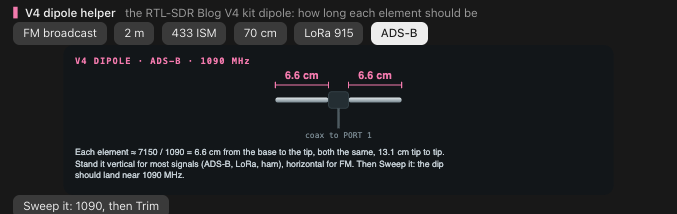</p>

Pick what you want to hear: FM 98, 2 m, 433, 70 cm, LoRa 915 or ADS-B 1090. It draws the dipole with each element's length, about 7150 ÷ MHz in centimetres (6.6 cm at 1090). Stand it vertical for most signals (ADS-B, LoRa, ham) and horizontal for FM. **Sweep it** switches to that band and opens Trim aimed at that frequency, so you can confirm the dip.

## Calibrating

A NanoVNA's numbers are only as good as its calibration, for the range you sweep, at the point you measure. Calibrate again whenever you change the range or add a cable or an adapter.

1. Press **Calibrate** (Measure) or **Calibrate → slot N** (Bands). On a band, the tab first sets the band's sweep, the mesh layout's traces, and markers on the band's target and edges.
2. Screw the **OPEN** plug onto PORT 1, at the end of any cable you measure through, and press **OPEN is on**.
3. Swap in the **SHORT** plug and press **SHORT is on**. The tab checks it reads like a short (about 180° from the OPEN) before it takes it.
4. Swap in the **LOAD** plug (50 Ω) and press **LOAD is on**. The tab checks it sits halfway between OPEN and SHORT, then saves.

It saves to slot 0 on the mesh band, or to the band's own slot, and then grades the LOAD's return loss: 40 dB or more is excellent, 30 dB good, and anything less says "weak, redo it". **Cancel** puts back the slot that was in use before.

> [!NOTE]
> The mesh Calibrate refuses unless the sweep is 850–980 MHz at 201 points, so slot 0 only ever gets the mesh band. `/vna cal` calibrates the band you're on from the command line.

## The guide

Press **?** (or type `/vna guide`) for "How the VNA tab works": a card for each place, for calibrating, for the buttons, and for running several sessions.

<p align="center">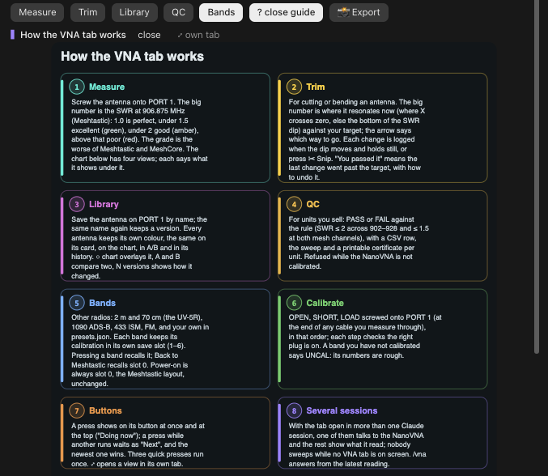</p>

Under the cards, **What this NanoVNA can do**, checked against DiSlord's firmware source, versions 1.2.40 and 1.2.46 (either side of the 1.2.44 on my H4):

- **Frequency range.** It sweeps from under 1 kHz to 2.7 GHz. Above 300 MHz it measures on its oscillator's harmonics, so readings get weaker and noisier the higher you go: its dynamic range is best below about 300 MHz.
- **Two measurements.** S11 on PORT 1 is what reflects back, for antennas. S21 from PORT 1 to PORT 2 is what passes through, for filters, cables and attenuators. This tab reads S11.
- **Cables and faults.** Its time-domain transform (TDR) turns a sweep into distance along a cable: its length, and where a fault is. The firmware also has cable, resonance and LC-match measure modes on its own screen.
- **Points and slots.** Up to 401 points a sweep (the tab uses 201), and 7 save slots on the H4, each a whole state: sweep, calibration, traces and markers.
- **Accuracy is the calibration.** See [Calibrating](#calibrating).
- **Never transmit into it.** Test antennas, not live outputs.

## The report card

One tall picture of the reading, ready to share. Press **📸 Export** on the top row (desktop or phone) or type `/vna export [name]`.

The card is built from the tab's own pictures, in their phone layouts, so it matches what you see:

1. A header: the name (or "Live"), the date and time, and the instrument, like `NanoVNA-H4 · fw 1.2.44 · calibrated 850–980 MHz`.
2. The big readout.
3. The SWR chart, with any overlays, and an A/B compare when one is set.
4. The Smith chart.
5. The numbers: SWR, return loss, reflected power, mismatch loss and impedance at 906.875, 910.525 and 915 MHz, then the best point, the width under 2:1, the resonance and the trim hint.
6. A "Wildcat RF" footer.

It's saved as `~/NanoVNA/exports/<name>-<yyyymmdd-hhmm>.svg` and `.png`, shown in Finder, and announced in a toast. The PNG is 540 px wide at 2x, so 1080 px: the right size for LinkedIn or TikTok. A second card with the same name in the same minute gets `-2`, so nothing is overwritten. [Here's an example card](images/report-card.png).

The PNG comes from headless Google Chrome (in a throwaway profile, with a 30-second alarm; its process group is killed and the profile deleted afterwards), or else `rsvg-convert`. With neither, the SVG stays, the tab says so, and the SVG opens in any browser.

## The status line

The line under the prompt shows only while a NanoVNA is connected:

| It says | When |
|---|---|
| `VNA · SWR 1.23 @907` | On the mesh band |
| `VNA · SWR 1.23 @907 · QC PASS` | In QC mode |
| `VNA · 2 m · SWR 1.41 @146.52` | On another band, at its target |
| `VNA · nothing on PORT 1` | PORT 1 reads open |

`/vna hide` puts it away and `/vna show` brings it back; the tab remembers which.

**Herdr.** The same line is also written to `~/.claude/mod-status/vna.json`, which the Herdr app's status strip reads to show it once for the whole window. Inside Herdr (it sets `HC_TERMINAL_ID` in every terminal) the line under the prompt is never set, since the strip shows it. Outside Herdr the status line works as usual, and the file is written too.

```
{"mod": "vna", "text": "SWR 1.23 @907", "level": "ok", "at": <ms since epoch>}
```

| `level` | When |
|---|---|
| `alert` | SWR 3 or more, or a QC FAIL |
| `warn` | SWR 2 or more, or nothing on PORT 1 |
| `ok` | Everything else |

<details>
<summary>How the Herdr file is written</summary>

- `text` is the status line without `VNA · `.
- It's written atomically: a temp file in the same folder, then `mv`.
- It's rewritten when the line changes (a change of the reading alone at most every 15 s) and at least every 10 minutes. Herdr hides entries older than 30 minutes.
- It's deleted when the NanoVNA is unplugged, and by `/vna hide`.
- [`hooks/mod-status.ts`](../hooks/mod-status.ts) does all of this.

</details>

## Commands

Every command answers within 7 seconds. A press that takes longer says "Working on it" and finishes in the tab.

**Reading**

| Command | What it does |
|---|---|
| `/vna` | The whole reading as text, from the shared reading when it's fresh |
| `/vna view swr\|rl\|rx\|smith` | Switches the chart and explains the view |
| `/vna markers mesh` | M1–M3 on the sweep points nearest 906.875, 910.525 and 915 MHz |
| `/vna markers best` | M1 on the lowest SWR |
| `/vna live on\|off` | Resumes or pauses the 3-second reading |
| `/vna tab <view>` | Opens `reading`, `chart`, `smith`, `trim`, `library`, `qc`, `bands` or `guide` in its own tab |
| `/vna guide` | How the tab works, and what this NanoVNA can do |

**Antennas**

| Command | What it does |
|---|---|
| `/vna save <name>` | Saves the antenna on PORT 1; the same name again adds a version |
| `/vna compare <a> <b>` | A side-by-side table; `/vna compare off` clears it |
| `/vna history <name>` | Every version of one antenna; `/vna history off` |
| `/vna delete <name>` | Deletes that antenna's newest version |
| `/vna trim [snip\|reset\|<MHz>\|meshtastic\|meshcore]` | The trim assistant as text; log a change; start a new timeline; aim at a frequency |

**QC**

| Command | What it does |
|---|---|
| `/vna qc` | QC mode on, with the verdict |
| `/vna qc off` | QC mode off |
| `/vna qc save [unit]` | Records the unit on PORT 1 |
| `/vna qc rules …` | Shows or changes the rule (see [QC](#qc)) |
| `/vna qc log` | The QC records, newest first |

**Bands and the NanoVNA**

| Command | What it does |
|---|---|
| `/vna band` | The bands, their slots and the power-on rule |
| `/vna band <id>` | Switches to a band (recalls its slot) |
| `/vna back` | Back to Meshtastic (recalls slot 0); also `/vna band mesh` |
| `/vna band cal <id>` | Calibrates a band into its slot |
| `/vna cal` | Calibrates the band you're on |
| `/vna x on\|off` | Trace 4 as X on the NanoVNA's screen, not saved |
| `/vna poweron` | Checks and explains the power-on save; the save itself is the tab's **Yes, save slot 0** |
| `/vna layout` | The mesh layout, not saved |
| `/vna shot` | A screenshot of the NanoVNA's screen |
| `/vna msg <text>` | Pops a message up on the NanoVNA's screen |

**Sharing and the status line**

| Command | What it does |
|---|---|
| `/vna export [name]` | The report card, as SVG and PNG, shown in Finder |
| `/vna hide`, `/vna show` | Hides or shows the status line and the Herdr strip's entry (remembered) |

## How it works

The tab talks to the NanoVNA through one script, [`scripts/vna.py`](../scripts/vna.py), and a few rules keep every press quick and every session polite.

### From a press to the NanoVNA

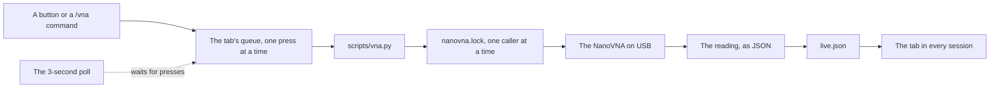

Every button follows the same rules:

- **Shown at once.** A press shows on its button in the very next drawing ("Placing…", "Saving…", "Recalling slot 0…"), and at the top as **Doing now**, with its step and "about N s" (learned from the last time).
- **One at a time, never dropped.** A press made while another runs waits, dimmed as "Queued: …", and shows as **Next** at the top. Only one waits: a newer press replaces it, so the last click wins. The same press again joins it, so three quick clicks run once.
- **A press says what it wants.** "Show X", "overlay this", "Back to Meshtastic", never "toggle". A second press from a drawing a moment old asks for the same thing again, and a press for what's already so changes nothing.
- **Presses before polls.** Device commands run one at a time. A press waits only for a sweep already under way, and polls never run while a press runs or waits. Reads that never touch the device (the library, the presets, the QC log) run beside them.

<details>
<summary>The timing log, field by field</summary>

Each press adds one line to `~/Library/Application Support/vna/actions.jsonl`. The last 1000 are kept.

| Field | What it is |
|---|---|
| `at` | When it was pressed, as an ISO time |
| `action` | The press, in words |
| `key` | What it asked for. The same key joins a press already running or waiting |
| `pressedAt`, `startedAt`, `finishedAt` | When, in ms since 1970 |
| `waitMs` | How long it waited behind another press |
| `runMs` | How long it ran |
| `expectMs` | What "about N s" said |
| `step` | Its step, in words |
| `queued` | Whether it had to wait |
| `coalesced` | Extra presses that joined it |
| `ok` | `false` with `failed`: the reason, also shown in a toast |
| `superseded`, `by` | Replaced by a newer press before it ran |

A poll that took over 300 ms adds a `{"poll": …, "ms": …, "lane": …}` line: always when a press waited behind it (`delayedAPress: true`), otherwise at most once in 10 minutes per kind.

When the tab feels slow:

```sh
tail -n 20 ~/Library/Application\ Support/vna/actions.jsonl | jq -c '{action, waitMs, runMs, expectMs, queued, coalesced, ok}'
```

</details>

### Several Claude sessions, one NanoVNA

With the tab open in several Claude sessions, only one of them talks to the NanoVNA. The others show what it read.

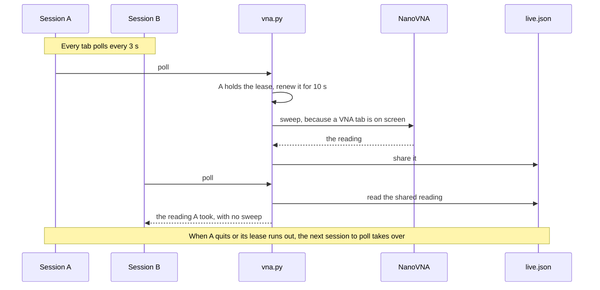

- **A lease.** The session that polls holds `~/Library/Caches/vna/lease.json`: its id, its Claude process, and until when (10 s, renewed with each poll). The others read the reading it writes to `~/Library/Application Support/vna/live.json`, stamped with when it was taken, and never sweep. When the holder's Claude process is gone, or its lease runs out, the next session to poll takes over.
- **Only when someone is looking.** A session whose VNA tab is on screen touches `~/Library/Caches/vna/watch-<session>`, and the holder sweeps only while one of these is under 10 s old. With no VNA tab on screen anywhere, nothing talks to the NanoVNA.
- **`/vna` always answers.** From the shared reading when it's under 10 s old; otherwise from one short sweep (waiting at most 2 s for the device, 7 s in all); otherwise with "NanoVNA busy", the last reading and how old it is.

<details>
<summary>Waits, watchdogs and other safety limits</summary>

- `vna.py` waits a bounded time for the device lock: 1.5 s for a poll, 2 s for `/vna`, 6 s for a press, 10 s for a calibration step. Past that it answers `busy`, with the last shared reading. Every device verb takes `--wait <s>` to change it (up to 30 s).
- A NanoVNA that doesn't answer `version` within 3 s is reported at once, instead of waiting out every command.
- Each verb has a watchdog that outlasts its wait for the lock, so a caller always gets one JSON answer.
- The port is opened exclusively (`TIOCEXCL`), so a second program can't interleave its commands with the tab's.
- A reading whose point count doesn't match the sweep is dropped as garbled.

</details>

### Finding the NanoVNA

The tab finds the NanoVNA's port in the Mac's USB device tree, by its product name, so it never opens any other serial device. That matters around mesh radios: opening a Meshtastic node's port turns its Bluetooth off.

> [!NOTE]
> Wi-Fi is experimental. The tab can also reach the NanoVNA through a Heltec V4 running a small bridge firmware, which isn't published yet. USB is the supported way.

**Save slots differ by board.** DiSlord's firmware keeps `SAVEAREA_MAX` slots (in `hardware.h`): 7 on the STM32F303 boards (NanoVNA-H4: slots 0–6) and 5 on the F072 NanoVNA-H (slots 0–4). `vna.py` picks by the board that `info` reports.

### Running vna.py on its own

`scripts/vna.py` is standard-library Python. It prints one JSON object per call and works without the tab:

```sh
python3 scripts/vna.py live
python3 scripts/vna.py band 2m
python3 scripts/vna.py presets
python3 scripts/vna.py poll --session x
python3 scripts/vna.py export --svg card.svg --name "Whip 1"
```

<details>
<summary>Every verb</summary>

| Verb | What it does |
|---|---|
| `status` | Whether it's connected, with the firmware, battery, calibration and sweep |
| `poll --session <id>` | The tab's 3-second poll: sweeps only for the session holding the lease, and only while a VNA tab is on screen |
| `shared` | The last shared reading, without touching the device |
| `live [--qc JSON]` | The status plus the current sweep: the SWR curve, raw S11 points, the mesh numbers, resonance, and with `--qc` the QC verdict |
| `save <label>` | `live`, plus a Touchstone `.s1p` in the library; the same label again keeps every sweep |
| `library` | Every saved sweep with its numbers, SWR curve and S11 |
| `delete <file>` | Removes one saved sweep |
| `markers mesh\|best` | M1–M3 on 906.875 / 910.525 / 915 MHz, or M1 on the lowest SWR |
| `qc [--rules JSON]` | The QC verdict for the antenna on PORT 1 |
| `qc save <unit> [--rules JSON]` | Records a QC test: the CSV row, the sweep and the certificate. Refused while not calibrated |
| `qc log` | The QC records, newest first, and the next unit number |
| `cal begin\|open\|short\|load\|cancel` | The guided mesh calibration, saved to slot 0 |
| `preset` | The mesh layout: 850–980 MHz, the traces and markers |
| `msg <text> [title]` | A message on the NanoVNA's screen |
| `shot` | A screenshot of the NanoVNA's screen, as a PNG |
| `presets` | The band presets, each band's slot and whether it has a calibration; no device |
| `band <id>` | Switches band: recalls a calibrated band's slot, slot 0 for `mesh`, or sweeps an uncalibrated band's range |
| `band cal <id> begin\|open\|short\|load\|cancel` | The guided calibration for a band, saved to its slot; slot 0 is refused |
| `xtrace on\|off` | Trace 4 as X of S11, live, not saved |
| `export --svg <file> --name <name>` | Files the tab's report card under `exports/`, makes the PNG and shows it in Finder; no device |
| `poweron save --confirm` | Saves slot 0, after every check |

Every device verb also takes `--wait <s>` and `--session <id>`.

</details>

These environment variables move things around, mostly for the tests:

| Variable | What it does |
|---|---|
| `NANOVNA_DIR` | Moves the library: sweeps, the QC log, certificates, screenshots and exports |
| `VNA_STATE_DIR` | Moves the state folder |
| `VNA_LOCK_DIR` | Moves the lock folder |
| `VNA_NO_DEVICE=1` | Finds no NanoVNA |
| `VNA_NO_REVEAL=1` | Doesn't open Finder after an export |
| `VNA_SVG_CONVERTER` | A program run as `<it> <svg> <png> 2` in place of Chrome or `rsvg-convert` |

## Files

Everything stays on local disk. Nothing lives in `~/Documents`: on my Mac it syncs to iCloud, and reading files there has stalled for minutes.

| Where | What |
|---|---|
| `~/NanoVNA/` | Your library: saved sweeps (`sweeps/`, Touchstone `.s1p`), `qc-log.csv`, QC certificates (`qc/`), `screenshots/` and report cards (`exports/`). Visible in Finder, not synced |
| `~/Library/Application Support/vna/` | The tab's state |
| `~/Library/Caches/vna/` | The device lock, the lease and the watch marks |
| `~/.claude/mod-status/vna.json` | The status line, for Herdr |

<details>
<summary>Every file, one by one</summary>

In `~/Library/Application Support/vna/`:

| File | What it holds |
|---|---|
| `presets.json` | Your own bands, the band → slot map, and each band's calibration record |
| `live.json` | The last shared reading, with when it was taken and by which session |
| `slot-state.json` | Which slot's calibration is in use, as far as the tab has seen |
| `cal-state.json` | A calibration under way |
| `bridge.json` | Where the experimental Wi-Fi bridge is |
| `actions.jsonl` | The timing log |

In `~/Library/Caches/vna/`:

| File | What it holds |
|---|---|
| `nanovna.lock` | One conversation with the NanoVNA at a time, across every session |
| `lease.json`, `lease.lock` | Which session polls, and until when |
| `watch-<session>` | A mark that this session's VNA tab is on screen |

In this repo:

| File | What it is |
|---|---|
| [`hooks/register.tsx`](../hooks/register.tsx) | The tab: every place, picture and press |
| [`hooks/mod-status.ts`](../hooks/mod-status.ts) | The status line and the Herdr file |
| [`scripts/vna.py`](../scripts/vna.py) | Everything that talks to the NanoVNA |
| [`tests/`](../tests/) | The tests, below |

</details>

## Tests

Two commands, run from the repo folder:

```sh
claude plugin test .                                   # the tab, on every surface
python3 -m unittest discover -s tests -p 'test_*.py'   # vna.py, against a fake NanoVNA
```

<details>
<summary>What <code>claude plugin test .</code> covers</summary>

It draws the tab on the terminal, the desktop, VS Code and the phone, from a captured real sweep, synthetic whips and a 2 m sweep, and checks:

- the five places; every picture's height and size in each; the hero, the trimming drawing and QC;
- the antenna cards in their own colours, with A and B in the same colours;
- presses: the pending label, queued presses, the newest waiting press winning, three presses running once, and a press waiting only for the sweep under way, with no polls meanwhile; and the timing log;
- several sessions: another session's reading shown with no sweeps, `/vna` from a fresh shared reading, a busy lock and a silent NanoVNA still answering, and a slow press answering in time;
- bands: switching to a band and back (recall N, then recall 0, with nothing calibrated or saved), a band on slot 0 offering no calibration, and the power-on button's refusals and its confirmation;
- the trim assistant's steps, crossing the target, and the undo hint;
- own tabs, and the export card: the tab's pictures, unique ids, sizes, the file names it hands on, and a failed PNG;
- the status line and its Herdr file: outside and inside Herdr, nothing while no NanoVNA is connected, unplugging, the levels, and hide and show.

</details>

<details>
<summary>What the Python tests cover</summary>

They run `vna.py`'s slot, band and power-on logic against a fake NanoVNA shell that keeps its own save slots, in throwaway folders, with no serial port opened:

- presets never write slot 0: every built-in band calibrates into its own slot, and slot 0 stays byte for byte;
- a band mapped to slot 0 is refused before anything is sent;
- switching to a band and back restores the power-on state exactly;
- an uncalibrated band sweeps without recalling or saving; a lost slot is reported; cancel goes back;
- the mesh calibration happens only on the mesh sweep;
- every power-on refusal, and the save itself;
- trace 4 as X of S11;
- the lease: taken, renewed, run out, and a dead holder; no device traffic with nobody watching;
- a busy lock answering at once for live, save and band;
- the export's file names and placement, and a failed converter keeping the SVG.

</details>
